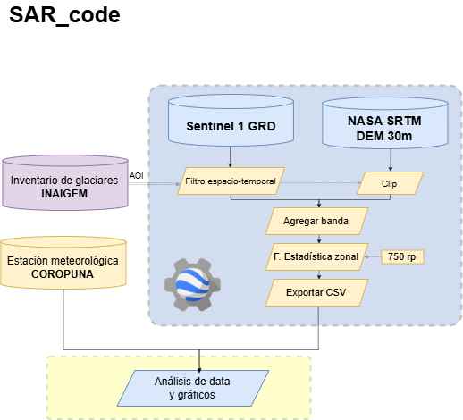
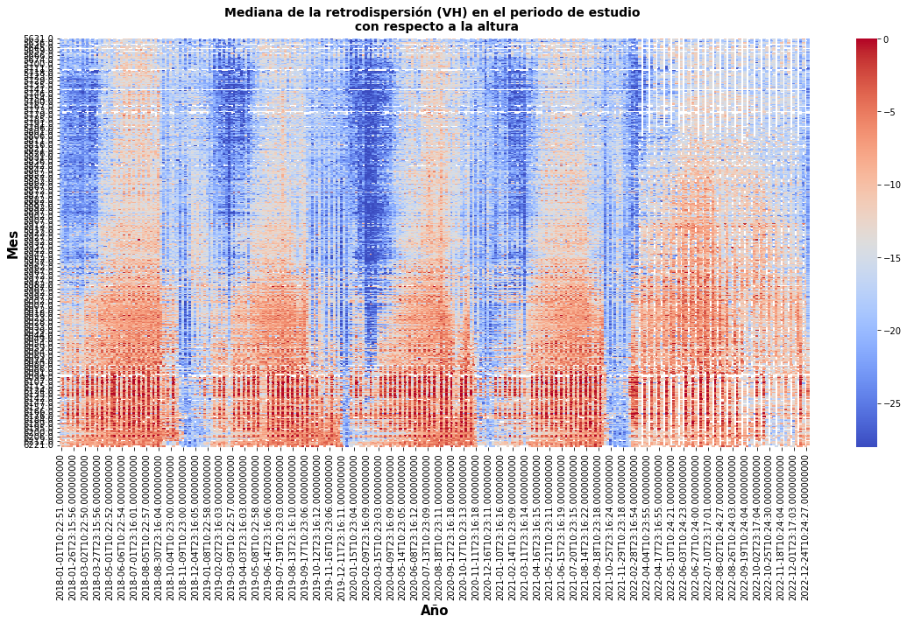

# SARglac

> **Proyecto archivado**

Este pequeño proyecto fue desarrollado en marzo de 2023 en el marco de la presentación para el **Encuentro Científico Internacional (ECI) de Verano 2023** en Lima-Perú [Ver PDF](Presentacion_CEM.pdf).

El objetivo principal fue mostrar el potencial del uso de series de tiempo con imágenes **SAR (Synthetic Aperture Radar)** para mapear y monitorear el estado y la cobertura de la nieve en una cordillera del Perú (Nevado Coropuna).

---

## Diagrama Metodológico

---

## Resultados preliminares

Los menores valores de retrodispersión, que están asociados a nieve húmeda, son frecuentes desde noviembre hasta abril. Mientras que los mayores valores de retrodispersión, asociados
con nieve seca, son frecuentes en los meses de mayo a octubre.

